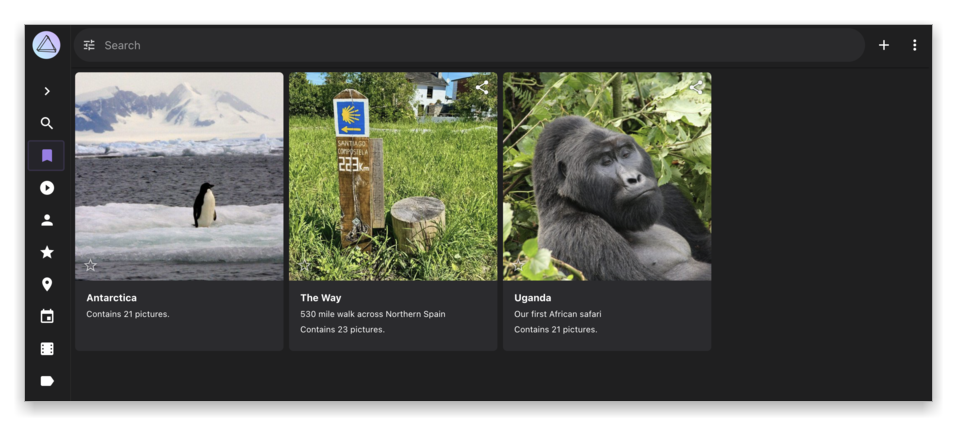
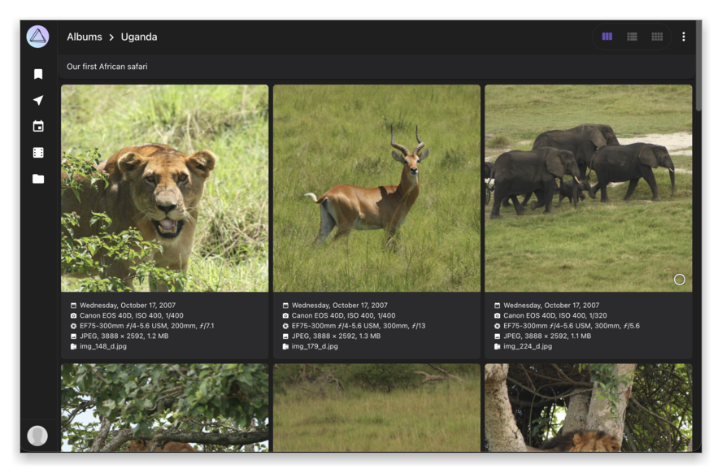
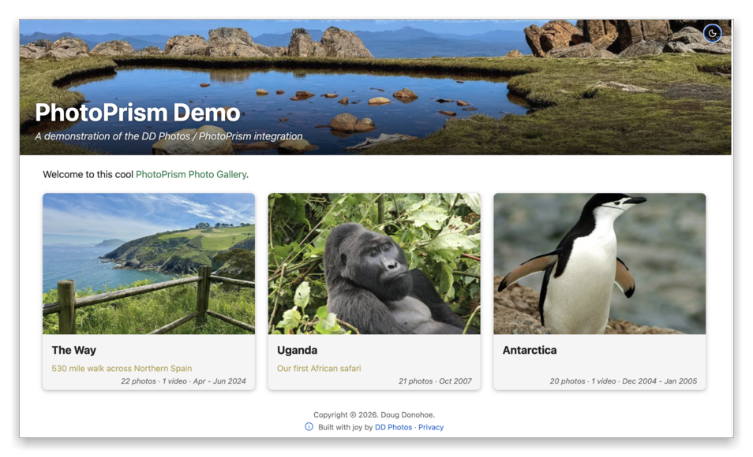
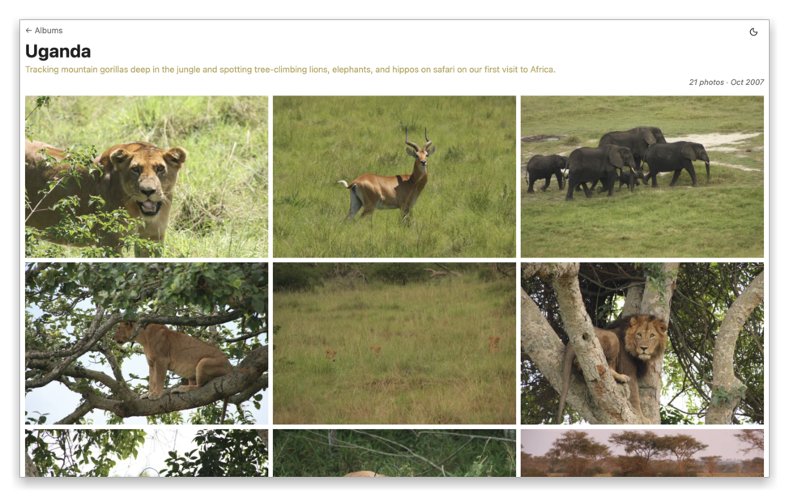
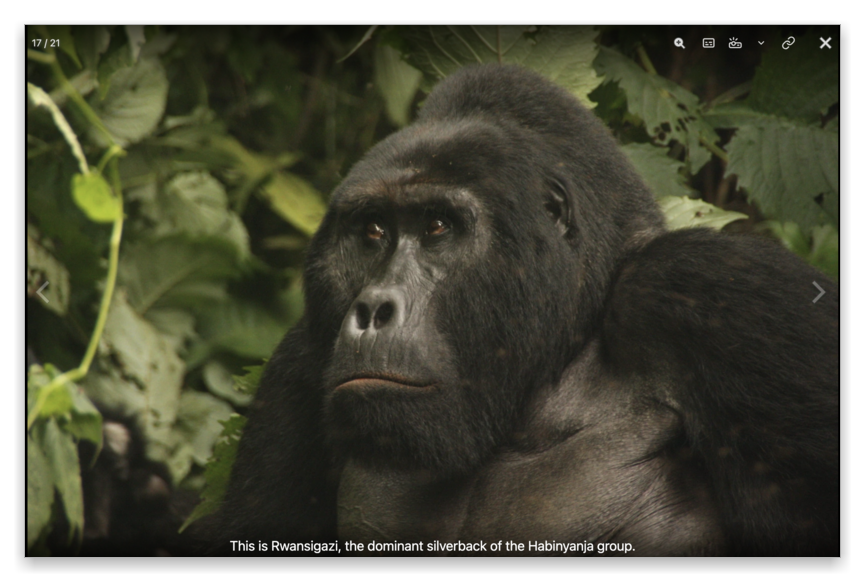
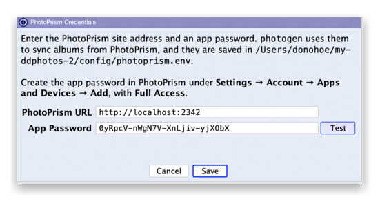
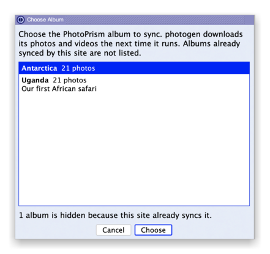
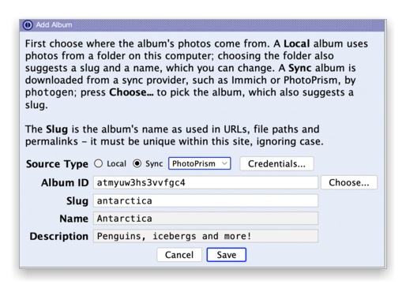
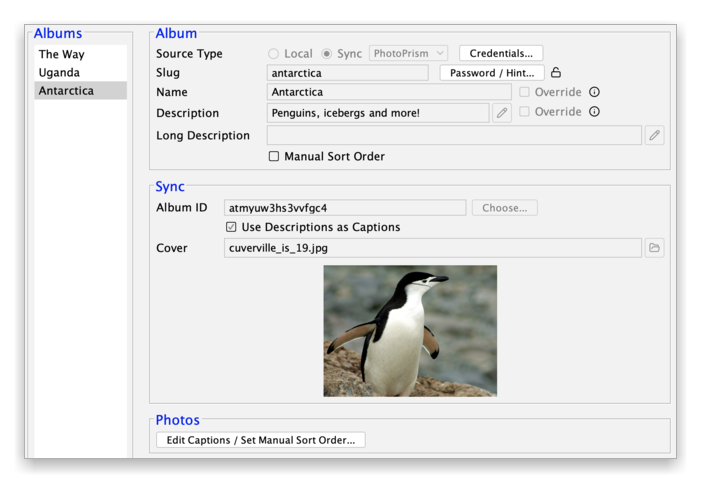

# DD Photos and PhotoPrism

DD Photos can sync albums straight from [PhotoPrism↗](https://www.photoprism.app), the popular
self-hosted photo manager. You pick a PhotoPrism album in the app, and DD Photos downloads its photos
and videos and builds them into a fast, static photo website. You don't need to export anything first.

This page shows how it works and how to set it up.

## Why not just share from PhotoPrism?

PhotoPrism's shared albums work well, but they have some limits:

- A shared link seems to show only one album at a time (it works sometimes, but inconsistently).
- The album grid shows a lot of camera and file details under each photo, not just your captions.
- You can't arrange the photos in your own order.
- The link only works while your PhotoPrism server is up and reachable from the internet.

DD Photos takes a different approach.

## Start in PhotoPrism

Here are three albums on a test PhotoPrism server:

And here is what a friend sees when you share the Uganda album from PhotoPrism:

It works, but there is a bit too
much clutter and technical details, the lightbox doesn't take full advantage of the entire screen,
and friends can't always discover or browse your other albums.

## End up with a site like this

DD Photos puts all your albums on one home page, with custom title, subtitle, overview and "hero" image. Each
album has a cover photo and a description:

Open an album, and you get a clean grid with less white space. It works great on phones and tablets,
and there is a dark theme too.

Tap a photo to see it full size, with its caption. Swipe (or use the arrow keys) to move through the
album. Videos play right in the album too.

The site is just static files. You can publish it for free on
[Cloudflare Pages↗](https://pages.cloudflare.com) or [Surge↗](https://surge.sh), or put it anywhere
with `rsync` or AWS S3. Your PhotoPrism server can stay private at home. Nobody visiting the site ever
touches it.

See a live example at [ddphotos.donohoe.info↗](https://ddphotos.donohoe.info).

## How to set it up

**1. Connect to PhotoPrism.** Choose **File → PhotoPrism Credentials...** and enter your site
address and an app password. Create the app password in PhotoPrism under
**Settings → Account → Apps and Devices → Add**, with **Full Access**. Press **Test** to check that
it works.

**2. Add an album.** In the Add Album dialog, choose **Sync** as the source type and **PhotoPrism**
as the provider, then press **Choose...**. DD Photos lists your PhotoPrism albums. Pick one.

DD Photos fills in the album's name and description, and suggests a URL name (the "slug"). Press
**Save**.

**3. Make it yours.** Keep the name and description from PhotoPrism, or override them just for your
site. Pick a cover photo. Turn on **Use Descriptions as Captions** to show each photo's PhotoPrism
**Caption** as its caption. You can also edit captions and set your own photo order, and those
changes are kept the next time you sync.

**4. Preview, Build and Publish.** Run `photogen` from the app. It downloads your photos and videos from
PhotoPrism and resizes them for the web. Later runs only download what is new or changed. Preview the
site on your computer, then publish it.

## A few things to know

- DD Photos downloads the original file, under the name it was uploaded with, rather than the JPEG
  PhotoPrism makes of a HEIC.
- For a Live Photo, the still photo is downloaded.
- For a RAW photo, PhotoPrism's JPEG of it is downloaded.
- Private, archived and hidden photos are skipped.
- Captions come from each photo's **Caption**. Its **Title** is not used, because PhotoPrism
  generates one for every photo from where and when it was taken.
- DD Photos runs its build tools in Docker, so you need Docker installed. The app's Setup Wizard
  walks you through it.

## Try it

Download the latest release from the [Installation](../README.md#installation) section of the main
README. Questions, ideas and bug reports are very welcome in
[GitHub Issues](https://github.com/dougdonohoe/ddphotos-app/issues).
